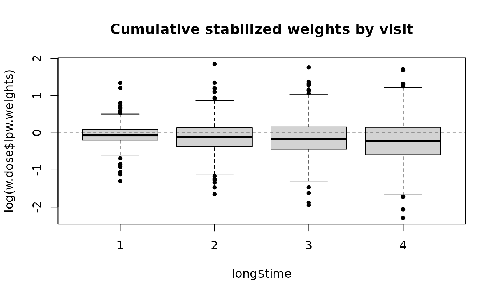
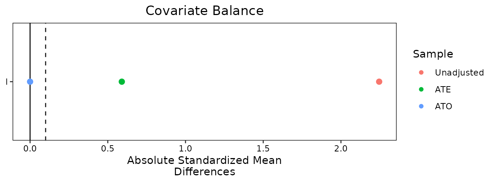

# Inverse probability weighting with ipw

``` r

library(ipw)
library(survival)
```

ipw estimates **inverse probability weights**: each person is weighted
by the inverse of the probability of the exposure they actually
received, given their confounders. In the weighted data, exposure no
longer depends on the measured confounders, and a simple model of
outcome on exposure, a **marginal structural model (MSM)**, estimates
the causal effect (Robins, Hernán & Brumback 2000; van der Wal & Geskus
2011).

An analysis has three steps:

1.  **Estimate the weights** with
    [`ipwpoint()`](https://tranhung93.github.io/ipw/reference/ipwpoint.md)
    (exposure measured once) or
    [`ipwtm()`](https://tranhung93.github.io/ipw/reference/ipwtm.md)
    (exposure that changes over time), or from your own probabilities
    with
    [`ipwprobtm()`](https://tranhung93.github.io/ipw/reference/ipwprobtm.md).
2.  **Check the weights** with
    [`summary()`](https://rdrr.io/r/base/summary.html) and
    [`ipwplot()`](https://tranhung93.github.io/ipw/reference/ipwplot.md).
3.  **Fit the MSM** with the weights, and get **standard errors**: with
    [`ipwvcov()`](https://tranhung93.github.io/ipw/reference/ipwvcov.md)
    for a binary point treatment, otherwise with a bootstrap that
    re-estimates the weights when they are well behaved (section 5).

| Function | Purpose |
|----|----|
| [`ipwpoint()`](https://tranhung93.github.io/ipw/reference/ipwpoint.md) | Weights for an exposure measured once (point treatment) |
| [`ipwtm()`](https://tranhung93.github.io/ipw/reference/ipwtm.md) | Weights for an exposure that changes over time, and censoring weights |
| [`ipwprobtm()`](https://tranhung93.github.io/ipw/reference/ipwprobtm.md) | Time-varying weights from probabilities you estimated yourself **(new)** |
| [`ipwvcov()`](https://tranhung93.github.io/ipw/reference/ipwvcov.md) | Standard errors for the MSM that account for the estimated weights (binary point treatment) **(new)** |
| [`ipwplot()`](https://tranhung93.github.io/ipw/reference/ipwplot.md) | Plot the distribution of the weights |
| [`tstartfun()`](https://tranhung93.github.io/ipw/reference/tstartfun.md) | Interval start times for counting-process (Cox) data |

> **New in the development version.** Sections marked **New** describe
> features added after ipw 1.3.2: count, gamma and log-normal exposures,
> smooth terms with mgcv, ATT, ATC and overlap weights (also for
> categorical exposures), standard errors that account for the estimated
> weights
> ([`ipwvcov()`](https://tranhung93.github.io/ipw/reference/ipwvcov.md)),
> `type = "all"` for categorical and survival exposures in
> [`ipwtm()`](https://tranhung93.github.io/ipw/reference/ipwtm.md), and
> [`ipwprobtm()`](https://tranhung93.github.io/ipw/reference/ipwprobtm.md).
> Existing calls give the same results as before. The formulas, code and
> rationale behind each new feature are in the [methods
> article](https://tranhung93.github.io/ipw/articles/methods.html).

**ipw or WeightIt?** For point treatments,
[WeightIt](https://ngreifer.github.io/WeightIt/) offers many more
weighting methods (machine learning, entropy and energy balancing, CBPS,
…), estimands, balance diagnostics through cobalt and outcome models
with M-estimation standard errors. ipw is designed for exposures that
change over time in long data with each person’s own visit times, Cox
models for the time to the first switch or to censoring, exposures that
switch back and forth or recur, count and skewed continuous exposures,
and analyses with few dependencies. See the README and the article [ipw,
WeightIt and PSweight side by
side](https://tranhung93.github.io/ipw/articles/ipw-and-weightit.html)
for a side-by-side comparison.

## 1. Point treatment: a binary exposure

We simulate a confounder `l`, a binary exposure `a` that is more likely
at high `l`, and an outcome `y`. The true causal effect of `a` on `y` is
10.

``` r

set.seed(16)
n <- 1000
simdat <- data.frame(l = rnorm(n, 10, 5))
simdat$a <- rbinom(n, 1, plogis(simdat$l - 10))
simdat$y <- 10 * simdat$a + 0.5 * simdat$l + rnorm(n, -10, 5)
```

[`ipwpoint()`](https://tranhung93.github.io/ipw/reference/ipwpoint.md)
fits the exposure model (here a logistic regression) and returns the
weights. With `numerator = ~ 1` the weights are **stabilized**: the
marginal probability of the exposure goes in the numerator, which keeps
the correction but makes the weights much less variable.

``` r

w <- ipwpoint(exposure = a, family = "binomial", link = "logit",
              numerator = ~ 1, denominator = ~ l, data = simdat)
summary(w$ipw.weights)
#>    Min. 1st Qu.  Median    Mean 3rd Qu.    Max. 
#>  0.4810  0.5127  0.5285  0.9095  0.6318 74.6994
ipwplot(weights = w$ipw.weights, logscale = FALSE, main = "Stabilized weights",
        xlim = c(0, 8))
```


Stabilized weights should have a mean close to 1. The exposure models
are returned as well, so they can be checked like any regression:

``` r

coef(w$den.mod)
#> (Intercept)           l 
#>  -9.6980874   0.9727157
```

The weighted regression of `y` on `a` estimates the causal effect; the
unweighted regression is confounded by `l`:

``` r

c(unweighted = unname(coef(lm(y ~ a, data = simdat))["a"]),
  weighted   = unname(coef(lm(y ~ a, data = simdat, weights = w$ipw.weights))["a"]))
#> unweighted   weighted 
#>   13.87050   10.64661
```

For inference, the weighted model is usually fitted with robust standard
errors, for example with the survey package as in the JSS paper; see
section 5 for
[`ipwvcov()`](https://tranhung93.github.io/ipw/reference/ipwvcov.md),
which also accounts for the estimation of the weights, and the
bootstrap.

``` r

msm <- survey::svyglm(y ~ a, design = survey::svydesign(~ 1, weights = ~ w$ipw.weights,
                                                        data = simdat))
cbind(estimate = coef(msm), confint(msm))["a", ]
#>  estimate     2.5 %    97.5 % 
#> 10.646610  8.311695 12.981525
```

**Unstabilized weights** use `numerator = NULL` (the default), and
**truncation** caps extreme weights at chosen percentiles:

``` r

w.unstab <- ipwpoint(exposure = a, family = "binomial", link = "logit",
                     denominator = ~ l, data = simdat)
w.trunc <- ipwpoint(exposure = a, family = "binomial", link = "logit",
                    numerator = ~ 1, denominator = ~ l, data = simdat, trunc = 0.01)
rbind(unstabilized = summary(w.unstab$ipw.weights),
      stabilized   = summary(w$ipw.weights),
      truncated    = summary(w.trunc$weights.trunc))
#>                   Min.   1st Qu.    Median      Mean  3rd Qu.       Max.
#> unstabilized 1.0000000 1.0046903 1.0482683 1.8260844 1.242464 155.300216
#> stabilized   0.4810000 0.5127181 0.5284768 0.9094652 0.631794  74.699404
#> truncated    0.4810092 0.5127181 0.5284768 0.7772294 0.631794   6.274768
```

### New: ATT, ATC and overlap weights

The weights above target the **average treatment effect (ATE)**: the
effect if everyone versus no one were exposed. With `estimand = "ATT"`
the weights target the effect **in the exposed** (exposed get weight 1,
unexposed p/(1 - p)); with `estimand = "ATC"` the effect **in the
unexposed** (the controls: exposed (1 - p)/p, unexposed 1); with
`estimand = "ATO"`, **overlap weights**, the effect in the people whose
exposure was most uncertain (exposed 1 - p, unexposed p, all between 0
and 1). Here p is the fitted probability of exposure.

``` r

fit.estimand <- function(estimand) {
  wt <- ipwpoint(exposure = a, family = "binomial", link = "logit",
                 denominator = ~ l, data = simdat, estimand = estimand)$ipw.weights
  c(effect = unname(coef(lm(y ~ a, data = simdat, weights = wt))["a"]),
    max.weight = max(wt))
}
sapply(c(ATE = "ATE", ATT = "ATT", ATC = "ATC", ATO = "ATO"), fit.estimand)
#>                  ATE        ATT      ATC        ATO
#> effect      10.64661   9.044102 11.95244 10.5137145
#> max.weight 155.30022 154.300216 19.88275  0.9935609
```

The effect was simulated as constant, so all four estimands are 10 in
truth, and the differences between the estimates are sampling noise. The
ATT weights show why: unexposed people with a high probability of
exposure get weights above 100, which makes that estimate unstable, and
the ATC weights do the same for exposed people with a low probability of
exposure. Overlap weights never exceed 1, which helps when some people
are almost always or almost never exposed. With an effect that differs
between people, the three estimands differ in truth as well.

## 2. Point treatment: other kinds of exposure

### Categorical and ordered exposures

For an exposure with more than two categories, `family = "multinomial"`
fits a multinomial logistic model and `family = "ordinal"` a
proportional-odds model (with `link = "logit"`, `"probit"`, `"cauchit"`
or `"cloglog"`).

``` r

set.seed(4)
cat.dat <- data.frame(l = rnorm(800))
eta <- 0.9 * cat.dat$l
cat.dat$dose <- cut(eta + rlogis(800), c(-Inf, -0.5, 0.8, Inf),
                    labels = c("low", "medium", "high"), ordered_result = TRUE)
w.ord <- ipwpoint(exposure = dose, family = "ordinal", link = "logit",
                  numerator = ~ 1, denominator = ~ l, data = cat.dat)
w.mult <- ipwpoint(exposure = dose, family = "multinomial",
                   numerator = ~ 1, denominator = ~ l, data = cat.dat)
rbind(ordinal = summary(w.ord$ipw.weights), multinomial = summary(w.mult$ipw.weights))
#>                  Min.   1st Qu.    Median      Mean  3rd Qu.     Max.
#> ordinal     0.3728385 0.7198835 0.8864612 0.9986363 1.095597 5.308914
#> multinomial 0.3563447 0.7223290 0.8959666 1.0031794 1.063840 7.484257
```

#### New: ATT and overlap weights for categorical exposures

For a categorical exposure, `estimand = "ATT"` targets the effect in the
people at one level, the **focal** level: each person gets P(focal) /
P(observed level), so people at the focal level keep weight 1 and the
others are reweighted to look like them. `estimand = "ATO"` gives
**generalized overlap weights** (Li & Li 2019): (1 / P(observed level))
/ sum over all levels k of 1 / P(k). Both need `numerator = NULL`. For
two levels they are the binomial ATT and ATO weights; for the effect in
the controls of a categorical exposure, use `"ATT"` with `focal` set to
the control level.

``` r

w.cat.att <- ipwpoint(exposure = dose, family = "multinomial", denominator = ~ l,
                  data = cat.dat, estimand = "ATT", focal = "high")
w.cat.ato <- ipwpoint(exposure = dose, family = "multinomial", denominator = ~ l,
                  data = cat.dat, estimand = "ATO")
rbind(ATT.high = tapply(w.cat.att$ipw.weights, cat.dat$dose, mean),
      ATO = tapply(w.cat.ato$ipw.weights, cat.dat$dose, mean))
#>                low    medium      high
#> ATT.high 0.8280057 1.1601986 1.0000000
#> ATO      0.2287016 0.3283241 0.2797272
```

### Continuous exposures

`healthdat` contains IQ, monthly income and a health score for 1000
simulated people; IQ confounds the effect of income on health. For a
continuous exposure the weights use densities instead of probabilities,
so a numerator model is required.

``` r

data(healthdat)
w.gauss <- ipwpoint(exposure = income, family = "gaussian",
                    numerator = ~ 1, denominator = ~ iq, data = healthdat)
summary(w.gauss$ipw.weights)
#>     Min.  1st Qu.   Median     Mean  3rd Qu.     Max. 
#>  0.01669  0.55729  0.72481  0.96870  0.93367 58.09496
coef(lm(health ~ income, data = healthdat, weights = w.gauss$ipw.weights))
#>  (Intercept)       income 
#> 47.167435110  0.008022911
```

#### New: skewed continuous exposures (gamma and log-normal)

Many exposures are positive with a long right tail, such as a dose or a
duration: most values are small and a few are very large. A normal model
is symmetric and fits that tail poorly, and the tail is where weights
become large. `family = "gamma"` (log link) and `family = "lognormal"`
(a normal model for the log of the exposure) are meant for such
exposures; both require positive values. Below, the dose is log-normal
given `l`, and the true effect of one unit of `dose` on `y` is 1.

``` r

set.seed(8)
n.sk <- 2000
sk <- data.frame(l = rnorm(n.sk))
sk$dose <- exp(0.5 + 0.5 * sk$l + rnorm(n.sk, 0, 0.6))
sk$y <- sk$dose + 2 * sk$l + rnorm(n.sk)
c(mean = mean(sk$dose), median = median(sk$dose))   # right-skewed
#>     mean   median 
#> 2.311130 1.655365

# weighted correlation of the dose (or log dose) with the confounder l
wcor <- function(x, w) cov.wt(cbind(x, sk$l), wt = w, cor = TRUE)$cor[1, 2]

fit.dose <- function(family) {
  w <- ipwpoint(exposure = dose, family = family, numerator = ~ 1,
                denominator = ~ l, data = sk, trunc = 0.01)
  wt <- w$weights.trunc
  c(cor.dose.l = wcor(sk$dose, wt), cor.logdose.l = wcor(log(sk$dose), wt),
    effect = unname(coef(lm(y ~ dose, data = sk, weights = wt))["dose"]),
    max.weight.untruncated = max(w$ipw.weights))
}
round(cbind(
  unweighted = c(wcor(sk$dose, rep(1, n.sk)), wcor(log(sk$dose), rep(1, n.sk)),
                 unname(coef(lm(y ~ dose, data = sk))["dose"]), 1),
  sapply(c(gaussian = "gaussian", gamma = "gamma", lognormal = "lognormal"), fit.dose)), 3)
#>                        unweighted gaussian   gamma lognormal
#> cor.dose.l                  0.564    0.333   0.256     0.171
#> cor.logdose.l               0.649    0.441   0.320     0.185
#> effect                      1.529    1.265   1.244     1.172
#> max.weight.untruncated      1.000 1825.069 491.946    37.537
```

Good weights make the exposure unrelated to the confounders, so the
table shows the weighted correlation of the dose (and of the log dose)
with `l`, next to the effect estimate and the largest weight. The
weights are truncated at the 1st and 99th percentiles (`trunc = 0.01`),
because a few extreme weights would otherwise dominate a single
estimate.

Without weights, the dose is strongly correlated with `l` (about 0.56)
and the estimate (about 1.53) is badly confounded. The log-normal model,
which matches how the dose was generated, removes most of that
correlation (about 0.17), gives the estimate closest to 1 (about 1.17)
and has by far the most moderate weights: its largest untruncated weight
is about 38, against about 1800 for the gaussian model. The gaussian
model puts almost no probability on the long right tail, so the few
people with a high dose get huge weights; the gamma model lies in
between. None of the models removes the correlation completely here,
partly because truncation trades a little bias for stability.

Choose the family by looking at the exposure: if it is right-skewed and
looks bell-shaped after taking logs, use `"lognormal"`; if its spread
grows with its mean, `"gamma"`. Do not use them for an exposure that is
roughly symmetric: income in `healthdat` (mean and median both about
2700) is modelled well by `"gaussian"`, and a log-normal model there
gives a few people with very low income enormous weights.

#### New: count exposures (Poisson and negative binomial)

For counts, such as a number of visits, `family = "poisson"` fits a
Poisson model and `family = "negbin"` a negative binomial model (via
[`MASS::glm.nb`](https://rdrr.io/pkg/MASS/man/glm.nb.html)) that allows
more spread than the Poisson. Here the true effect of each extra visit
on `y` is 0.5.

``` r

set.seed(6)
cnt <- data.frame(l = rnorm(1000))
cnt$visits <- rnbinom(1000, size = 2, mu = exp(0.5 + 0.4 * cnt$l))
cnt$y <- 0.5 * cnt$visits + cnt$l + rnorm(1000)
c(mean = mean(cnt$visits), variance = var(cnt$visits))   # variance > mean
#>     mean variance 
#> 1.853000 4.483875
w.pois <- ipwpoint(exposure = visits, family = "poisson",
                   numerator = ~ 1, denominator = ~ l, data = cnt)
w.nb <- ipwpoint(exposure = visits, family = "negbin",
                 numerator = ~ 1, denominator = ~ l, data = cnt)
sapply(list(poisson = w.pois, negbin = w.nb), function(x)
  c(effect = unname(coef(lm(y ~ visits, data = cnt, weights = x$ipw.weights))["visits"]),
    max.weight = max(x$ipw.weights)))
#>               poisson    negbin
#> effect      0.3779291 0.5500115
#> max.weight 20.1565447 5.9796435
```

The variance is clearly larger than the mean, so the negative binomial
model is the better choice for these data.

### New: smooth terms with mgcv

A regression assumes a straight-line effect of each confounder on the
logit of the exposure probability. When the true relation is curved, the
weights leave residual confounding. Writing `s(l)` in a formula fits the
exposure model as a generalized additive model with mgcv, which
estimates the shape of the curve from the data. Smooth terms work in
[`ipwpoint()`](https://tranhung93.github.io/ipw/reference/ipwpoint.md)
for the binomial, gaussian and Poisson families and in
[`ipwtm()`](https://tranhung93.github.io/ipw/reference/ipwtm.md) for the
binomial family. The true effect below is 2.

``` r

set.seed(10)
nl <- data.frame(l = runif(2000, -2, 2))
nl$a <- rbinom(2000, 1, plogis(2 * sin(1.5 * nl$l)))
nl$y <- 2 * nl$a + 3 * sin(1.5 * nl$l) + rnorm(2000)

w.lin <- ipwpoint(exposure = a, family = "binomial", link = "logit",
                  numerator = ~ 1, denominator = ~ l, data = nl)
w.gam <- ipwpoint(exposure = a, family = "binomial", link = "logit",
                  numerator = ~ 1, denominator = ~ s(l), data = nl)
c(unweighted   = unname(coef(lm(y ~ a, data = nl))["a"]),
  linear.model = unname(coef(lm(y ~ a, data = nl, weights = w.lin$ipw.weights))["a"]),
  smooth.model = unname(coef(lm(y ~ a, data = nl, weights = w.gam$ipw.weights))["a"]))
#>   unweighted linear.model smooth.model 
#>     4.437406     2.682710     2.084703
```

`plot(w.gam$den.mod)` shows the fitted curve. A covariate that is simply
named `s`, `te`, `ti` or `t2` is treated as an ordinary variable.

## 3. Exposure that changes over time

### HAART and mortality (`haartdat`)

`haartdat` contains simulated follow-up of 1200 HIV-infected patients
from seroconversion, one row per 100 days. Patients can start HAART
(`haartind` becomes 1 and stays 1). CD4 count is a time-varying
confounder: low CD4 leads to starting HAART and to death, and HAART
raises CD4. Ordinary adjustment for CD4 would remove part of the effect
of HAART; weighting does not.

``` r

data(haartdat)
head(haartdat[, c("patient", "tstart", "fuptime", "haartind", "event", "cd4.sqrt", "dropout")])
#>   patient tstart fuptime haartind event cd4.sqrt dropout
#> 1       1   -100       0        0     0 23.83275       0
#> 2       1      0     100        0     0 25.59297       0
#> 3       1    100     200        0     0 23.47339       0
#> 4       1    200     300        0     0 24.16609       0
#> 5       1    300     400        0     0 23.23790       0
#> 6       1    400     500        0     0 24.85961       0
```

[`ipwtm()`](https://tranhung93.github.io/ipw/reference/ipwtm.md) with
`family = "survival"` fits Cox models for the time to starting HAART.
With `type = "first"`, each patient contributes until HAART is started,
because afterwards starting is no longer a choice. A second set of
weights corrects for **informative censoring**: dropout also depends on
CD4.

``` r

w.haart <- ipwtm(exposure = haartind, family = "survival",
                 numerator = ~ sex + age, denominator = ~ sex + age + cd4.sqrt,
                 id = patient, tstart = tstart, timevar = fuptime,
                 type = "first", data = haartdat)
w.cens <- ipwtm(exposure = dropout, family = "survival",
                numerator = ~ sex + age, denominator = ~ sex + age + cd4.sqrt,
                id = patient, tstart = tstart, timevar = fuptime,
                type = "cens", data = haartdat)
summary(w.haart$ipw.weights * w.cens$ipw.weights)
#>    Min. 1st Qu.  Median    Mean 3rd Qu.    Max. 
#>  0.2500  0.8944  0.9862  1.0346  1.0718  7.0921
ipwplot(weights = w.haart$ipw.weights, timevar = haartdat$fuptime, binwidth = 100,
        main = "Stabilized weights for starting HAART")
```


The MSM is a weighted Cox model for death with the product of the two
weights:

``` r

msm.haart <- coxph(Surv(tstart, fuptime, event) ~ haartind + cluster(patient),
                   data = haartdat, weights = w.haart$ipw.weights * w.cens$ipw.weights)
summary(msm.haart)$conf.int
#>          exp(coef) exp(-coef) lower .95 upper .95
#> haartind 0.3920629   2.550611 0.1614445 0.9521124
```

[`tstartfun()`](https://tranhung93.github.io/ipw/reference/tstartfun.md)
builds the interval start times needed for such data from the end times:

``` r

toy <- data.frame(patient = c(1, 1, 1, 2, 2), time = c(14, 34, 41, 0, 11))
toy$tstart <- tstartfun(patient, time, toy)
toy
#>   patient time tstart
#> 1       1   14     -1
#> 2       1   34     14
#> 3       1   41     34
#> 4       2    0     -1
#> 5       2   11      0
```

Other families work in
[`ipwtm()`](https://tranhung93.github.io/ipw/reference/ipwtm.md) as
well: `"binomial"` (pooled logistic regression), `"multinomial"`,
`"ordinal"` and `"gaussian"` (GEE, with `type = "all"`).

### New: categorical exposures that switch back and forth

With `type = "all"`, every interval contributes the probability of the
category observed in it, so an exposure can move between categories in
both directions. This now works for multinomial and ordinal exposures.
The models are pooled over time, so **past exposure belongs in the
formulas**; here the previous dose level `dose.lag`.

``` r

set.seed(3)
n.id <- 300
long <- data.frame(id = rep(seq_len(n.id), each = 4), time = rep(1:4, times = n.id))
long$l <- rnorm(nrow(long))
long$dose <- NA
long$dose.lag <- NA
for (t in 1:4) {
  rows <- long$time == t
  prev <- if (t == 1) rep(1, n.id) else long$dose[long$time == t - 1]
  eta <- -1 + 0.8 * long$l[rows] + 0.7 * (prev - 1)
  u <- runif(n.id)
  long$dose.lag[rows] <- prev
  long$dose[rows] <- ifelse(u < plogis(eta - 1.5), 3, ifelse(u < plogis(eta), 2, 1))
}
long$dose <- factor(long$dose, levels = 1:3, labels = c("low", "medium", "high"),
                    ordered = TRUE)

w.dose <- ipwtm(exposure = dose, family = "ordinal", link = "logit",
                numerator = ~ dose.lag, denominator = ~ dose.lag + l,
                id = id, timevar = time, type = "all", data = long)
summary(w.dose$ipw.weights)
#>    Min. 1st Qu.  Median    Mean 3rd Qu.    Max. 
#>  0.1015  0.6728  0.8916  1.0009  1.1278  6.3704
ipwplot(weights = w.dose$ipw.weights, timevar = long$time, binwidth = 1,
        main = "Cumulative stabilized weights by visit")
```



### New: recurrent exposure events in survival models

`family = "survival"` previously allowed only `type = "first"`. With
`type = "all"` (Graffeo, Latouche, Geskus & Chevret 2018), the exposure
indicator marks an exposure event at the end of an interval, such as a
new prescription, that may happen **more than once** per person. An
Andersen-Gill Cox model is fitted on all rows, and each row contributes
the probability of the observed status over its own interval. The
intervals may be irregular and differ between people.

``` r

set.seed(21)
n.id <- 300
rec <- do.call(rbind, lapply(seq_len(n.id), function(i) {
  k <- sample(3:6, 1)
  cuts <- sort(runif(k))
  data.frame(id = i, tstart = c(0, cuts[-k]), fuptime = cuts)
}))
rec$x <- rep(rbinom(n.id, 1, 0.5), times = as.vector(table(rec$id)))  # fixed covariate
rec$xt <- rbinom(nrow(rec), 1, 0.4)                                    # time-varying
rec$expo <- rbinom(nrow(rec), 1, plogis(-1 + 0.5 * rec$x - rec$xt))   # exposure events

w.first <- ipwtm(exposure = expo, family = "survival", numerator = ~ x,
                 denominator = ~ x + xt, id = id, tstart = tstart, timevar = fuptime,
                 type = "first", data = rec)
w.all <- ipwtm(exposure = expo, family = "survival", numerator = ~ x,
               denominator = ~ x + xt, id = id, tstart = tstart, timevar = fuptime,
               type = "all", data = rec)
c(rows.used.first = sum(w.first$selvar), rows.used.all = sum(w.all$selvar))
#> rows.used.first   rows.used.all 
#>             832            1376
rbind(first = summary(w.first$ipw.weights), all = summary(w.all$ipw.weights))
#>            Min.   1st Qu.    Median      Mean  3rd Qu.     Max.
#> first 0.6670722 0.8388009 0.9308970 0.9804538 1.066893 1.571507
#> all   0.3741005 0.8114862 0.9444067 0.9815656 1.087444 2.394201
```

With `type = "first"`, the rows after a person’s first exposure event
are ignored; with `type = "all"` they all count. For a treatment that is
started and stopped, Graffeo et al. compute weights separately for
starting (on the rows off treatment) and for stopping (on the rows on
treatment).

## 4. New: weights from your own probabilities

If you estimated the exposure probabilities yourself, for example with a
machine-learning model or SuperLearner, the weights are easy to form.
For a point treatment no function is needed: the stabilized weight is
the numerator probability divided by the probability of the exposure
each person actually received. Below, a cubic logistic model stands in
for a flexible learner.

``` r

p.flex <- fitted(glm(a ~ poly(l, 3), family = binomial, data = simdat))
#> Warning: glm.fit: fitted probabilities numerically 0 or 1 occurred
den.own <- ifelse(simdat$a == 1, p.flex, 1 - p.flex)
num.own <- ifelse(simdat$a == 1, mean(simdat$a), 1 - mean(simdat$a))
w.own <- num.own / den.own
summary(w.own)
#>    Min. 1st Qu.  Median    Mean 3rd Qu.    Max. 
#>  0.4810  0.5095  0.5301  0.8856  0.6332 58.5053
coef(lm(y ~ a, data = simdat, weights = w.own))["a"]
#>        a 
#> 10.92033
```

For time-varying data,
[`ipwprobtm()`](https://tranhung93.github.io/ipw/reference/ipwprobtm.md)
does the part that is easy to get wrong: it multiplies the ratios within
each person in time order (the data need not be sorted), returns the
weights in the order of the input and can truncate them.

``` r

toy <- data.frame(id = c(1, 1, 2, 2), time = c(1, 2, 1, 2), p = c(0.5, 0.8, 0.4, 0.9))
ipwprobtm(den = toy$p, id = toy$id, timevar = toy$time)$ipw.weights
#> [1] 2.000000 2.500000 2.500000 2.777778
```

For weights of `type = "first"` or `"cens"`, set the probabilities to 1
for the rows after the first switch. The warning from
[`glm()`](https://rdrr.io/r/stats/glm.html) above is a reminder of the
main risk: flexible models can produce probabilities close to 0 or 1 and
therefore extreme weights. Check the weights and consider `trunc`.

## 5. Standard errors: M-estimation, robust and bootstrap

### New: `ipwvcov()` for a binary point treatment

For a binary point treatment and a marginal structural model fitted with
[`lm()`](https://rdrr.io/r/stats/lm.html) or
[`glm()`](https://rdrr.io/r/stats/glm.html),
[`ipwvcov()`](https://tranhung93.github.io/ipw/reference/ipwvcov.md)
returns the variance-covariance matrix of the MSM coefficients with the
estimation of the weights taken into account. The MSM and the exposure
model(s) are solved together as one set of estimating equations
(M-estimation, Lunceford & Davidian 2004), and the sandwich variance of
all parameters is computed. It works for every estimand (ATE, ATT, ATC,
ATO), stabilized or not, and is the recommended option in this setting.
It is new and still experimental. Fit the MSM on the same rows as
[`ipwpoint()`](https://tranhung93.github.io/ipw/reference/ipwpoint.md),
with `weights = w$ipw.weights`:

``` r

msm.lm <- lm(y ~ a, data = simdat, weights = w$ipw.weights)
se.mest <- sqrt(diag(ipwvcov(w, msm.lm)))
se.mest
#> (Intercept)           a 
#>    1.052322    1.086986
```

`lmtest::coeftest(msm.lm, vcov. = ipwvcov(w, msm.lm))` gives Wald tests
and [`lmtest::coefci()`](https://rdrr.io/pkg/lmtest/man/coeftest.html)
confidence intervals.
[`ipwvcov()`](https://tranhung93.github.io/ipw/reference/ipwvcov.md)
needs a logistic exposure model (`link = "logit"`), and does not handle
truncated weights, smooth terms, other exposure families or time-varying
weights from
[`ipwtm()`](https://tranhung93.github.io/ipw/reference/ipwtm.md); for
these, use the bootstrap below.

### Robust and bootstrap standard errors

Robust (sandwich) standard errors treat the weights as known. In
simulations of weighted Cox models, Austin (2016) found naive standard
errors too small and robust standard errors too large; the bootstrap
that **re-estimates the weights in each bootstrap sample** gave correct
standard errors and confidence intervals. Robust standard errors are not
always too large, though: they can be too small for a continuous
exposure and for time-varying weights (see below), and the bootstrap is
then preferred.

A bootstrap takes a few lines: draw a sample with replacement,
re-estimate the weights and the MSM on it, and repeat.

``` r

msm.effect <- function(d) {
  wt <- ipwpoint(exposure = a, family = "binomial", link = "logit",
                 numerator = ~ 1, denominator = ~ l, data = d)$ipw.weights
  coef(lm(y ~ a, data = d, weights = wt))["a"]
}
set.seed(1)
boot.est <- replicate(200, msm.effect(simdat[sample(nrow(simdat), replace = TRUE), ]))
c(estimate = unname(msm.effect(simdat)), bootstrap.se = sd(boot.est),
  m.estimation.se = unname(se.mest["a"]))
#>        estimate    bootstrap.se m.estimation.se 
#>       10.646610        1.113812        1.086986
quantile(boot.est, c(0.025, 0.975))   # percentile 95% confidence interval
#>      2.5%     97.5% 
#>  8.867114 12.850280
```

For data with several rows per person, resample **people**, not rows:
keep all rows of a sampled person and give each sampled copy a new
identifier, so that someone drawn twice counts as two people. Here both
sets of weights for the HAART example are re-estimated in each sample
(use about 200 samples in practice; 20 keep this vignette quick):

``` r

haart.effect <- function(d) {
  w1 <- ipwtm(exposure = haartind, family = "survival", numerator = ~ sex + age,
              denominator = ~ sex + age + cd4.sqrt, id = patient,
              tstart = tstart, timevar = fuptime, type = "first", data = d)
  w2 <- ipwtm(exposure = dropout, family = "survival", numerator = ~ sex + age,
              denominator = ~ sex + age + cd4.sqrt, id = patient,
              tstart = tstart, timevar = fuptime, type = "cens", data = d)
  coef(coxph(Surv(tstart, fuptime, event) ~ haartind, data = d,
             weights = w1$ipw.weights * w2$ipw.weights))
}
rows.by.patient <- split(seq_len(nrow(haartdat)), haartdat$patient)
cluster.sample <- function() {
  pick <- sample(length(rows.by.patient), replace = TRUE)
  rows <- rows.by.patient[pick]
  d <- haartdat[unlist(rows), ]
  d$patient <- rep(seq_along(pick), lengths(rows))   # new id per sampled copy
  d
}
set.seed(2)
boot.haart <- replicate(20, haart.effect(cluster.sample()))
c(robust.se = unname(sqrt(diag(vcov(msm.haart)))), bootstrap.se = sd(boot.haart))
#>    robust.se bootstrap.se 
#>    0.4526924    0.3620001
```

**When does the bootstrap help?** The [simulation
study](https://tranhung93.github.io/ipw/articles/simulations.html) gives
a mixed answer:

- For a point treatment with **good overlap**, the bootstrap standard
  error was accurate, while robust standard errors were about 12% too
  large.
- For a **weighted Cox model** with good overlap, naive, robust and
  bootstrap standard errors were all close to correct.
- When some **weights are extreme**, through poor overlap (the `simdat`
  example above) or through products of time-varying weights over
  several visits, all standard errors were too small, the bootstrap ones
  included, and 95% confidence intervals covered the truth in only 57 to
  80% of samples.

So the bootstrap does not repair unstable weights. Check the weights
first (section 6), and if some are extreme, consider truncation
(`trunc`), overlap weights (`estimand = "ATO"`) or a better exposure
model before relying on any standard error.

## 6. Checking the weights

- **Mean close to 1.** Stabilized weights should average about 1; a mean
  far from 1 suggests a misspecified exposure model.
- **Extreme weights.** Very large weights point to **positivity**
  problems: some kinds of people (almost) never receive one of the
  exposures. Look at
  [`ipwplot()`](https://tranhung93.github.io/ipw/reference/ipwplot.md),
  reconsider the model, use overlap weights (`estimand = "ATO"`) or
  truncate (`trunc`), keeping in mind that truncation slightly changes
  what is estimated.
- **Assumptions.** The weighted analysis assumes no unmeasured
  confounding, positivity, consistency and correctly specified exposure
  (and censoring) models.

### Covariate balance

Good weights make the confounders unrelated to the exposure, so after
weighting their distribution should be the same in the exposure groups.
Check this directly: it tests the exposure model where it matters. The
cobalt package (Greifer) computes balance statistics for any weights;
ipw’s weights are passed as a plain vector, with `method = "weighting"`.
The standardized mean difference (SMD) uses the pooled standard
deviation of the unweighted groups (`s.d.denom = "pooled"`); absolute
SMDs below 0.1 are a common rule of thumb.

``` r

cobalt::bal.tab(a ~ l, data = simdat, weights = w$ipw.weights,
                method = "weighting", s.d.denom = "pooled", un = TRUE)
#> Balance Measures
#>      Type Diff.Un Diff.Adj
#> l Contin.  2.2457   0.5901
#> 
#> Effective sample sizes
#>            Control Treated
#> Unadjusted  481.    519.  
#> Adjusted     26.55  191.61
```

Several sets of weights can be compared at once; `love.plot()` draws the
SMDs before and after weighting. Here the stabilized ATE weights and the
overlap weights from section 1:

``` r

w.ato <- ipwpoint(exposure = a, family = "binomial", link = "logit",
                  denominator = ~ l, data = simdat, estimand = "ATO")
```

``` r

bal <- cobalt::bal.tab(a ~ l, data = simdat, method = "weighting",
                       weights = data.frame(ATE = w$ipw.weights, ATO = w.ato$ipw.weights),
                       s.d.denom = "pooled", un = TRUE)
cobalt::love.plot(bal, thresholds = c(m = 0.1), abs = TRUE)
```



With a logistic denominator model, overlap weights balance the mean of
every covariate in the model exactly (SMD 0). The stabilized ATE weights
reduce the SMD of `l` from about 2.2 to about 0.6, which is still far
above 0.1: with the poor overlap in these data, a few unexposed people
with a high `l` carry most of the weight (see the effective sample sizes
below), and their weighted mean of `l` is unstable. This is the same
problem that made the ATT weights extreme in section 1.

For time-varying weights, check balance at each time point among the
people for whom the exposure decision is made there. With
`type = "first"`, these are the rows with `selvar == 1` (not yet on
HAART at the start of the interval), and the groups are those who start
HAART in that interval and those who do not; the weight of each row is
the cumulative weight up to and including that interval. The censoring
weights do not depend on whether HAART is started, so only the HAART
weights are used here.

``` r

at.risk <- w.haart$selvar == 1 & haartdat$fuptime %in% c(100, 500)
haart.sub <- haartdat[at.risk, ]
cobalt::bal.tab(haartind ~ cd4.sqrt + sex + age, data = haart.sub,
                weights = w.haart$ipw.weights[at.risk], method = "weighting",
                s.d.denom = "pooled", un = TRUE, cluster = "fuptime")
#> Balance by cluster
#> 
#> ─── Cluster: 100 ────────────────
#> 
#> Balance Measures
#>             Type Diff.Un Diff.Adj
#> cd4.sqrt Contin.  0.2515   0.9290
#> sex       Binary -0.1060  -0.0193
#> age      Contin. -0.0636  -0.0650
#> 
#> Effective sample sizes
#>                  0     1
#> Unadjusted 1116.   47.  
#> Adjusted   1114.52 31.46
#> 
#> ─── Cluster: 500 ────────────────
#> 
#> Balance Measures
#>             Type Diff.Un Diff.Adj
#> cd4.sqrt Contin. -0.8234  -0.3827
#> sex       Binary  0.0699   0.0632
#> age      Contin. -0.0785  -0.0825
#> 
#> Effective sample sizes
#>                 0     1
#> Unadjusted 821.   31.  
#> Adjusted   811.67 27.28
```

We show this example as it is, rather than picking a time point where
the weights look good, because a balance check is only useful if it can
fail. The result is mixed, and that is useful to know. At 500 days,
weighting halves the imbalance in CD4 count (SMD from about -0.8 to
-0.4) but does not remove it; at 100 days, where the few people starting
HAART happened to have a higher CD4 count, it over-corrects (SMD from
0.25 to above 0.9). The denominator model is one Cox model with a single
CD4 coefficient for the whole follow-up; pooled over all at-risk rows,
weighting reduces the SMD of CD4 from about -0.47 to 0.13. Balance at
single time points with only 30 to 50 people starting HAART is noisy,
but a pattern like this suggests checking whether the effect of CD4 on
starting HAART changes over follow-up, for example by adding an
interaction with a time-period indicator to the denominator model.

Sex and age are in the numerator as well as the denominator model, so
the stabilized weights deliberately leave them unbalanced: they must be
adjusted for in the MSM (e.g. `coxph(... ~ haartind + sex + age)`).
Unstabilized weights (`numerator = NULL`) would balance them too, at the
price of more variable weights.

### Effective sample size

Variable weights reduce the information in the data. Kish’s **effective
sample size**, (sum of weights)^2 / (sum of squared weights), is the
size of an unweighted sample with about the same precision. Compute it
overall and by exposure group; a large drop in one group means a few
people carry most of the weight there.

``` r

ess <- function(w) sum(w)^2 / sum(w^2)
rbind(n = c(all = nrow(simdat), table(simdat$a)),
      ATE = c(ess(w$ipw.weights), tapply(w$ipw.weights, simdat$a, ess)),
      ATO = c(ess(w.ato$ipw.weights), tapply(w.ato$ipw.weights, simdat$a, ess)))
#>            all         0        1
#> n   1000.00000 481.00000 519.0000
#> ATE   84.56724  26.55499 191.6117
#> ATO  306.02035 152.98533 153.0350
```

[`cobalt::bal.tab()`](https://ngreifer.github.io/cobalt/reference/bal.tab.html)
reports the same quantity by group under “Effective sample sizes”.

## References

- Austin PC (2016). Variance estimation when using inverse probability
  of treatment weighting (IPTW) with survival analysis. *Statistics in
  Medicine* 35, 5642-5655. <doi:10.1002/sim.7084>.
- Cole SR, Hernán MA (2008). Constructing inverse probability weights
  for marginal structural models. *American Journal of Epidemiology*
  168, 656-664.
- Graffeo N, Latouche A, Geskus RB, Chevret S (2018). Modeling
  time-varying exposure using inverse probability of treatment weights.
  *Biometrical Journal* 60, 323-332. <doi:10.1002/bimj.201600223>.
- Greifer N. cobalt: Covariate Balance Tables and Plots. R package,
  <https://ngreifer.github.io/cobalt/>.
- Li F, Li F (2019). Propensity score weighting for causal inference
  with multiple treatments. *Annals of Applied Statistics* 13,
  2389-2415.
- Li F, Morgan KL, Zaslavsky AM (2018). Balancing covariates via
  propensity score weighting. *Journal of the American Statistical
  Association* 113, 390-400.
- Lunceford JK, Davidian M (2004). Stratification and weighting via the
  propensity score in estimation of causal treatment effects: a
  comparative study. *Statistics in Medicine* 23, 2937-2960.
  <doi:10.1002/sim.1903>.
- Robins JM, Hernán MA, Brumback B (2000). Marginal structural models
  and causal inference in epidemiology. *Epidemiology* 11, 550-560.
- van der Wal WM, Geskus RB (2011). ipw: An R package for inverse
  probability weighting. *Journal of Statistical Software* 43(13), 1-23.
  <doi:10.18637/jss.v043.i13>.
- Wood SN (2017). *Generalized Additive Models: An Introduction with R*,
  2nd ed. CRC Press.
