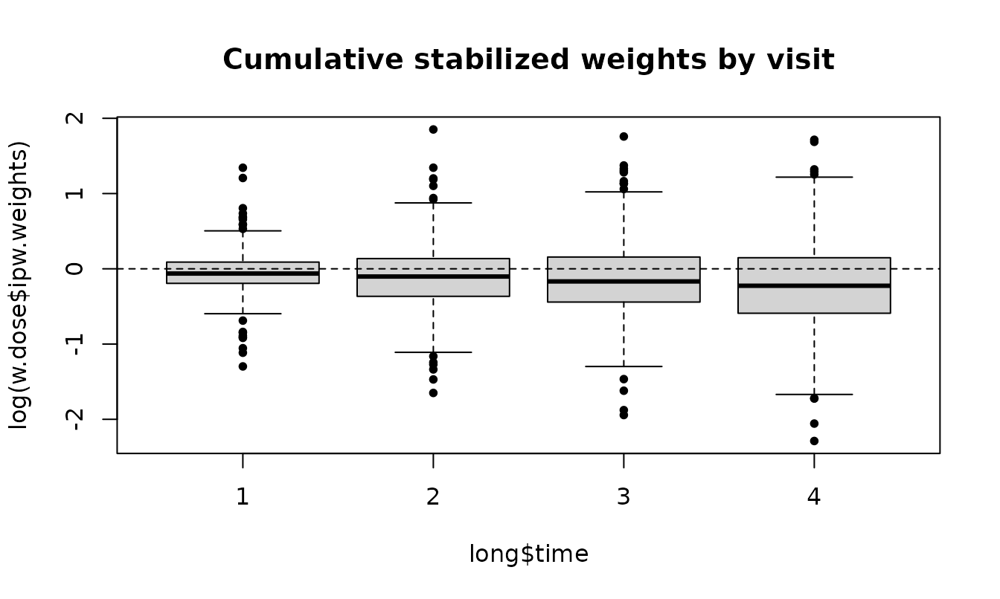

# Inverse probability weighting with ipw

``` r

library(ipw)
library(survival)
```

ipw estimates **inverse probability weights**: each person is weighted
by the inverse of the probability of the exposure they actually
received, given their confounders. In the weighted data, exposure no
longer depends on the measured confounders, and a simple model of
outcome on exposure, a **marginal structural model (MSM)**, estimates
the causal effect (Robins, Hernán & Brumback 2000; van der Wal & Geskus
2011).

An analysis has three steps:

1.  **Estimate the weights** with
    [`ipwpoint()`](https://tranhung93.github.io/ipw/reference/ipwpoint.md)
    (exposure measured once) or
    [`ipwtm()`](https://tranhung93.github.io/ipw/reference/ipwtm.md)
    (exposure that changes over time), or from your own probabilities
    with
    [`ipwprob()`](https://tranhung93.github.io/ipw/reference/ipwprob.md).
2.  **Check the weights** with
    [`summary()`](https://rdrr.io/r/base/summary.html) and
    [`ipwplot()`](https://tranhung93.github.io/ipw/reference/ipwplot.md).
3.  **Fit the MSM** with the weights, and get **standard errors**,
    preferably with
    [`ipwboot()`](https://tranhung93.github.io/ipw/reference/ipwboot.md).

| Function | Purpose |
|----|----|
| [`ipwpoint()`](https://tranhung93.github.io/ipw/reference/ipwpoint.md) | Weights for an exposure measured once (point treatment) |
| [`ipwtm()`](https://tranhung93.github.io/ipw/reference/ipwtm.md) | Weights for an exposure that changes over time, and censoring weights |
| [`ipwprob()`](https://tranhung93.github.io/ipw/reference/ipwprob.md) | Weights from probabilities you estimated yourself **(new)** |
| [`ipwboot()`](https://tranhung93.github.io/ipw/reference/ipwboot.md) | Bootstrap standard errors that re-estimate the weights **(new)** |
| [`ipwplot()`](https://tranhung93.github.io/ipw/reference/ipwplot.md) | Plot the distribution of the weights |
| [`tstartfun()`](https://tranhung93.github.io/ipw/reference/tstartfun.md) | Interval start times for counting-process (Cox) data |

> **New in the development version.** Sections marked **New** describe
> features added after ipw 1.3.2: count, gamma and log-normal exposures,
> smooth terms with mgcv, ATT and overlap weights, `type = "all"` for
> categorical and survival exposures in
> [`ipwtm()`](https://tranhung93.github.io/ipw/reference/ipwtm.md),
> [`ipwprob()`](https://tranhung93.github.io/ipw/reference/ipwprob.md)
> and
> [`ipwboot()`](https://tranhung93.github.io/ipw/reference/ipwboot.md).
> Existing calls give the same results as before.

## 1. Point treatment: a binary exposure

We simulate a confounder `l`, a binary exposure `a` that is more likely
at high `l`, and an outcome `y`. The true causal effect of `a` on `y` is
10.

``` r

set.seed(16)
n <- 1000
simdat <- data.frame(l = rnorm(n, 10, 5))
simdat$a <- rbinom(n, 1, plogis(simdat$l - 10))
simdat$y <- 10 * simdat$a + 0.5 * simdat$l + rnorm(n, -10, 5)
```

[`ipwpoint()`](https://tranhung93.github.io/ipw/reference/ipwpoint.md)
fits the exposure model (here a logistic regression) and returns the
weights. With `numerator = ~ 1` the weights are **stabilized**: the
marginal probability of the exposure goes in the numerator, which keeps
the correction but makes the weights much less variable.

``` r

w <- ipwpoint(exposure = a, family = "binomial", link = "logit",
              numerator = ~ 1, denominator = ~ l, data = simdat)
summary(w$ipw.weights)
#>    Min. 1st Qu.  Median    Mean 3rd Qu.    Max. 
#>  0.4810  0.5127  0.5285  0.9095  0.6318 74.6994
ipwplot(weights = w$ipw.weights, logscale = FALSE, main = "Stabilized weights",
        xlim = c(0, 8))
```


Stabilized weights should have a mean close to 1. The exposure models
are returned as well, so they can be checked like any regression:

``` r

coef(w$den.mod)
#> (Intercept)           l 
#>  -9.6980874   0.9727157
```

The weighted regression of `y` on `a` estimates the causal effect; the
unweighted regression is confounded by `l`:

``` r

c(unweighted = unname(coef(lm(y ~ a, data = simdat))["a"]),
  weighted   = unname(coef(lm(y ~ a, data = simdat, weights = w$ipw.weights))["a"]))
#> unweighted   weighted 
#>   13.87050   10.64661
```

For inference, the weighted model is usually fitted with robust standard
errors, for example with the survey package as in the JSS paper; see
section 7 for why the bootstrap is better.

``` r

msm <- survey::svyglm(y ~ a, design = survey::svydesign(~ 1, weights = ~ w$ipw.weights,
                                                        data = simdat))
cbind(estimate = coef(msm), confint(msm))["a", ]
#>  estimate     2.5 %    97.5 % 
#> 10.646610  8.311695 12.981525
```

**Unstabilized weights** use `numerator = NULL` (the default), and
**truncation** caps extreme weights at chosen percentiles:

``` r

w.unstab <- ipwpoint(exposure = a, family = "binomial", link = "logit",
                     denominator = ~ l, data = simdat)
w.trunc <- ipwpoint(exposure = a, family = "binomial", link = "logit",
                    numerator = ~ 1, denominator = ~ l, data = simdat, trunc = 0.01)
rbind(unstabilized = summary(w.unstab$ipw.weights),
      stabilized   = summary(w$ipw.weights),
      truncated    = summary(w.trunc$weights.trunc))
#>                   Min.   1st Qu.    Median      Mean  3rd Qu.       Max.
#> unstabilized 1.0000000 1.0046903 1.0482683 1.8260844 1.242464 155.300216
#> stabilized   0.4810000 0.5127181 0.5284768 0.9094652 0.631794  74.699404
#> truncated    0.4810092 0.5127181 0.5284768 0.7772294 0.631794   6.274768
```

### New: ATT and overlap weights

The weights above target the **average treatment effect (ATE)**: the
effect if everyone versus no one were exposed. With `estimand = "ATT"`
the weights target the effect **in the exposed** (exposed get weight 1,
unexposed p/(1 - p)); with `estimand = "ATO"`, **overlap weights**, the
effect in the people whose exposure was most uncertain (exposed 1 - p,
unexposed p, all between 0 and 1). Here p is the fitted probability of
exposure.

``` r

fit.estimand <- function(estimand) {
  wt <- ipwpoint(exposure = a, family = "binomial", link = "logit",
                 denominator = ~ l, data = simdat, estimand = estimand)$ipw.weights
  c(effect = unname(coef(lm(y ~ a, data = simdat, weights = wt))["a"]),
    max.weight = max(wt))
}
sapply(c(ATE = "ATE", ATT = "ATT", ATO = "ATO"), fit.estimand)
#>                  ATE        ATT        ATO
#> effect      10.64661   9.044102 10.5137145
#> max.weight 155.30022 154.300216  0.9935609
```

The effect was simulated as constant, so all three estimands are 10 in
truth, and the differences between the estimates are sampling noise. The
ATT weights show why: unexposed people with a high probability of
exposure get weights above 100, which makes that estimate unstable.
Overlap weights never exceed 1, which helps when some people are almost
always or almost never exposed. With an effect that differs between
people, the three estimands differ in truth as well.

## 2. Point treatment: other kinds of exposure

### Categorical and ordered exposures

For an exposure with more than two categories, `family = "multinomial"`
fits a multinomial logistic model and `family = "ordinal"` a
proportional-odds model (with `link = "logit"`, `"probit"`, `"cauchit"`
or `"cloglog"`).

``` r

set.seed(4)
cat.dat <- data.frame(l = rnorm(800))
eta <- 0.9 * cat.dat$l
cat.dat$dose <- cut(eta + rlogis(800), c(-Inf, -0.5, 0.8, Inf),
                    labels = c("low", "medium", "high"), ordered_result = TRUE)
w.ord <- ipwpoint(exposure = dose, family = "ordinal", link = "logit",
                  numerator = ~ 1, denominator = ~ l, data = cat.dat)
w.mult <- ipwpoint(exposure = dose, family = "multinomial",
                   numerator = ~ 1, denominator = ~ l, data = cat.dat)
rbind(ordinal = summary(w.ord$ipw.weights), multinomial = summary(w.mult$ipw.weights))
#>                  Min.   1st Qu.    Median      Mean  3rd Qu.     Max.
#> ordinal     0.3728385 0.7198835 0.8864612 0.9986363 1.095597 5.308914
#> multinomial 0.3563447 0.7223290 0.8959666 1.0031794 1.063840 7.484257
```

### Continuous exposures

`healthdat` contains IQ, monthly income and a health score for 1000
simulated people; IQ confounds the effect of income on health. For a
continuous exposure the weights use densities instead of probabilities,
so a numerator model is required.

``` r

data(healthdat)
w.gauss <- ipwpoint(exposure = income, family = "gaussian",
                    numerator = ~ 1, denominator = ~ iq, data = healthdat)
summary(w.gauss$ipw.weights)
#>     Min.  1st Qu.   Median     Mean  3rd Qu.     Max. 
#>  0.01669  0.55729  0.72481  0.96870  0.93367 58.09496
coef(lm(health ~ income, data = healthdat, weights = w.gauss$ipw.weights))
#>  (Intercept)       income 
#> 47.167435110  0.008022911
```

#### New: skewed continuous exposures (gamma and log-normal)

Many exposures are positive with a long right tail, such as a dose or a
duration: most values are small and a few are very large. A normal model
is symmetric and fits that tail poorly, and the tail is where weights
become large. `family = "gamma"` (log link) and `family = "lognormal"`
(a normal model for the log of the exposure) are meant for such
exposures; both require positive values. Below, the dose is log-normal
given `l`, and the true effect of one unit of `dose` on `y` is 1.

``` r

set.seed(8)
n.sk <- 2000
sk <- data.frame(l = rnorm(n.sk))
sk$dose <- exp(0.5 + 0.5 * sk$l + rnorm(n.sk, 0, 0.6))
sk$y <- sk$dose + 2 * sk$l + rnorm(n.sk)
c(mean = mean(sk$dose), median = median(sk$dose))   # right-skewed
#>     mean   median 
#> 2.311130 1.655365

# weighted correlation of the dose (or log dose) with the confounder l
wcor <- function(x, w) cov.wt(cbind(x, sk$l), wt = w, cor = TRUE)$cor[1, 2]

fit.dose <- function(family) {
  w <- ipwpoint(exposure = dose, family = family, numerator = ~ 1,
                denominator = ~ l, data = sk, trunc = 0.01)
  wt <- w$weights.trunc
  c(cor.dose.l = wcor(sk$dose, wt), cor.logdose.l = wcor(log(sk$dose), wt),
    effect = unname(coef(lm(y ~ dose, data = sk, weights = wt))["dose"]),
    max.weight.untruncated = max(w$ipw.weights))
}
round(cbind(
  unweighted = c(wcor(sk$dose, rep(1, n.sk)), wcor(log(sk$dose), rep(1, n.sk)),
                 unname(coef(lm(y ~ dose, data = sk))["dose"]), 1),
  sapply(c(gaussian = "gaussian", gamma = "gamma", lognormal = "lognormal"), fit.dose)), 3)
#>                        unweighted gaussian   gamma lognormal
#> cor.dose.l                  0.564    0.333   0.256     0.171
#> cor.logdose.l               0.649    0.441   0.320     0.185
#> effect                      1.529    1.265   1.244     1.172
#> max.weight.untruncated      1.000 1825.069 491.946    37.537
```

Good weights make the exposure unrelated to the confounders, so the
table shows the weighted correlation of the dose (and of the log dose)
with `l`, next to the effect estimate and the largest weight. The
weights are truncated at the 1st and 99th percentiles (`trunc = 0.01`),
because a few extreme weights would otherwise dominate a single
estimate.

Without weights, the dose is strongly correlated with `l` (about 0.56)
and the estimate (about 1.53) is badly confounded. The log-normal model,
which matches how the dose was generated, removes most of that
correlation (about 0.17), gives the estimate closest to 1 (about 1.17)
and has by far the most moderate weights: its largest untruncated weight
is about 38, against about 1800 for the gaussian model. The gaussian
model puts almost no probability on the long right tail, so the few
people with a high dose get huge weights; the gamma model lies in
between. None of the models removes the correlation completely here,
partly because truncation trades a little bias for stability.

Choose the family by looking at the exposure: if it is right-skewed and
looks bell-shaped after taking logs, use `"lognormal"`; if its spread
grows with its mean, `"gamma"`. Do not use them for an exposure that is
roughly symmetric: income in `healthdat` (mean and median both about
2700) is modelled well by `"gaussian"`, and a log-normal model there
gives a few people with very low income enormous weights.

#### New: count exposures (Poisson and negative binomial)

For counts, such as a number of visits, `family = "poisson"` fits a
Poisson model and `family = "negbin"` a negative binomial model (via
[`MASS::glm.nb`](https://rdrr.io/pkg/MASS/man/glm.nb.html)) that allows
more spread than the Poisson. Here the true effect of each extra visit
on `y` is 0.5.

``` r

set.seed(6)
cnt <- data.frame(l = rnorm(1000))
cnt$visits <- rnbinom(1000, size = 2, mu = exp(0.5 + 0.4 * cnt$l))
cnt$y <- 0.5 * cnt$visits + cnt$l + rnorm(1000)
c(mean = mean(cnt$visits), variance = var(cnt$visits))   # variance > mean
#>     mean variance 
#> 1.853000 4.483875
w.pois <- ipwpoint(exposure = visits, family = "poisson",
                   numerator = ~ 1, denominator = ~ l, data = cnt)
w.nb <- ipwpoint(exposure = visits, family = "negbin",
                 numerator = ~ 1, denominator = ~ l, data = cnt)
sapply(list(poisson = w.pois, negbin = w.nb), function(x)
  c(effect = unname(coef(lm(y ~ visits, data = cnt, weights = x$ipw.weights))["visits"]),
    max.weight = max(x$ipw.weights)))
#>               poisson    negbin
#> effect      0.3779291 0.5500115
#> max.weight 20.1565447 5.9796435
```

The variance is clearly larger than the mean, so the negative binomial
model is the better choice for these data.

### New: smooth terms with mgcv

A regression assumes a straight-line effect of each confounder on the
logit of the exposure probability. When the true relation is curved, the
weights leave residual confounding. Writing `s(l)` in a formula fits the
exposure model as a generalized additive model with mgcv, which
estimates the shape of the curve from the data. Smooth terms work in
[`ipwpoint()`](https://tranhung93.github.io/ipw/reference/ipwpoint.md)
for the binomial, gaussian and Poisson families and in
[`ipwtm()`](https://tranhung93.github.io/ipw/reference/ipwtm.md) for the
binomial family. The true effect below is 2.

``` r

set.seed(10)
nl <- data.frame(l = runif(2000, -2, 2))
nl$a <- rbinom(2000, 1, plogis(2 * sin(1.5 * nl$l)))
nl$y <- 2 * nl$a + 3 * sin(1.5 * nl$l) + rnorm(2000)

w.lin <- ipwpoint(exposure = a, family = "binomial", link = "logit",
                  numerator = ~ 1, denominator = ~ l, data = nl)
w.gam <- ipwpoint(exposure = a, family = "binomial", link = "logit",
                  numerator = ~ 1, denominator = ~ s(l), data = nl)
c(unweighted   = unname(coef(lm(y ~ a, data = nl))["a"]),
  linear.model = unname(coef(lm(y ~ a, data = nl, weights = w.lin$ipw.weights))["a"]),
  smooth.model = unname(coef(lm(y ~ a, data = nl, weights = w.gam$ipw.weights))["a"]))
#>   unweighted linear.model smooth.model 
#>     4.437406     2.682710     2.084703
```

`plot(w.gam$den.mod)` shows the fitted curve. A covariate that is simply
named `s`, `te`, `ti` or `t2` is treated as an ordinary variable.

## 3. Exposure that changes over time

### HAART and mortality (`haartdat`)

`haartdat` contains simulated follow-up of 1200 HIV-infected patients
from seroconversion, one row per 100 days. Patients can start HAART
(`haartind` becomes 1 and stays 1). CD4 count is a time-varying
confounder: low CD4 leads to starting HAART and to death, and HAART
raises CD4. Ordinary adjustment for CD4 would remove part of the effect
of HAART; weighting does not.

``` r

data(haartdat)
head(haartdat[, c("patient", "tstart", "fuptime", "haartind", "event", "cd4.sqrt", "dropout")])
#>   patient tstart fuptime haartind event cd4.sqrt dropout
#> 1       1   -100       0        0     0 23.83275       0
#> 2       1      0     100        0     0 25.59297       0
#> 3       1    100     200        0     0 23.47339       0
#> 4       1    200     300        0     0 24.16609       0
#> 5       1    300     400        0     0 23.23790       0
#> 6       1    400     500        0     0 24.85961       0
```

[`ipwtm()`](https://tranhung93.github.io/ipw/reference/ipwtm.md) with
`family = "survival"` fits Cox models for the time to starting HAART.
With `type = "first"`, each patient contributes until HAART is started,
because afterwards starting is no longer a choice. A second set of
weights corrects for **informative censoring**: dropout also depends on
CD4.

``` r

w.haart <- ipwtm(exposure = haartind, family = "survival",
                 numerator = ~ sex + age, denominator = ~ sex + age + cd4.sqrt,
                 id = patient, tstart = tstart, timevar = fuptime,
                 type = "first", data = haartdat)
w.cens <- ipwtm(exposure = dropout, family = "survival",
                numerator = ~ sex + age, denominator = ~ sex + age + cd4.sqrt,
                id = patient, tstart = tstart, timevar = fuptime,
                type = "cens", data = haartdat)
summary(w.haart$ipw.weights * w.cens$ipw.weights)
#>    Min. 1st Qu.  Median    Mean 3rd Qu.    Max. 
#>  0.2500  0.8944  0.9862  1.0346  1.0718  7.0921
ipwplot(weights = w.haart$ipw.weights, timevar = haartdat$fuptime, binwidth = 100,
        main = "Stabilized weights for starting HAART")
```


The MSM is a weighted Cox model for death with the product of the two
weights:

``` r

msm.haart <- coxph(Surv(tstart, fuptime, event) ~ haartind + cluster(patient),
                   data = haartdat, weights = w.haart$ipw.weights * w.cens$ipw.weights)
summary(msm.haart)$conf.int
#>          exp(coef) exp(-coef) lower .95 upper .95
#> haartind 0.3920629   2.550611 0.1614445 0.9521124
```

[`tstartfun()`](https://tranhung93.github.io/ipw/reference/tstartfun.md)
builds the interval start times needed for such data from the end times:

``` r

toy <- data.frame(patient = c(1, 1, 1, 2, 2), time = c(14, 34, 41, 0, 11))
toy$tstart <- tstartfun(patient, time, toy)
toy
#>   patient time tstart
#> 1       1   14     -1
#> 2       1   34     14
#> 3       1   41     34
#> 4       2    0     -1
#> 5       2   11      0
```

Other families work in
[`ipwtm()`](https://tranhung93.github.io/ipw/reference/ipwtm.md) as
well: `"binomial"` (pooled logistic regression), `"multinomial"`,
`"ordinal"` and `"gaussian"` (GEE, with `type = "all"`).

### New: categorical exposures that switch back and forth

With `type = "all"`, every interval contributes the probability of the
category observed in it, so an exposure can move between categories in
both directions. This now works for multinomial and ordinal exposures.
The models are pooled over time, so **past exposure belongs in the
formulas**; here the previous dose level `dose.lag`.

``` r

set.seed(3)
n.id <- 300
long <- data.frame(id = rep(seq_len(n.id), each = 4), time = rep(1:4, times = n.id))
long$l <- rnorm(nrow(long))
long$dose <- NA
long$dose.lag <- NA
for (t in 1:4) {
  rows <- long$time == t
  prev <- if (t == 1) rep(1, n.id) else long$dose[long$time == t - 1]
  eta <- -1 + 0.8 * long$l[rows] + 0.7 * (prev - 1)
  u <- runif(n.id)
  long$dose.lag[rows] <- prev
  long$dose[rows] <- ifelse(u < plogis(eta - 1.5), 3, ifelse(u < plogis(eta), 2, 1))
}
long$dose <- factor(long$dose, levels = 1:3, labels = c("low", "medium", "high"),
                    ordered = TRUE)

w.dose <- ipwtm(exposure = dose, family = "ordinal", link = "logit",
                numerator = ~ dose.lag, denominator = ~ dose.lag + l,
                id = id, timevar = time, type = "all", data = long)
summary(w.dose$ipw.weights)
#>    Min. 1st Qu.  Median    Mean 3rd Qu.    Max. 
#>  0.1015  0.6728  0.8916  1.0009  1.1278  6.3704
ipwplot(weights = w.dose$ipw.weights, timevar = long$time, binwidth = 1,
        main = "Cumulative stabilized weights by visit")
```



### New: recurrent exposure events in survival models

`family = "survival"` previously allowed only `type = "first"`. With
`type = "all"` (Graffeo, Latouche, Geskus & Chevret 2018), the exposure
indicator marks an exposure event at the end of an interval, such as a
new prescription, that may happen **more than once** per person. An
Andersen-Gill Cox model is fitted on all rows, and each row contributes
the probability of the observed status over its own interval. The
intervals may be irregular and differ between people.

``` r

set.seed(21)
n.id <- 300
rec <- do.call(rbind, lapply(seq_len(n.id), function(i) {
  k <- sample(3:6, 1)
  cuts <- sort(runif(k))
  data.frame(id = i, tstart = c(0, cuts[-k]), fuptime = cuts)
}))
rec$x <- rep(rbinom(n.id, 1, 0.5), times = as.vector(table(rec$id)))  # fixed covariate
rec$xt <- rbinom(nrow(rec), 1, 0.4)                                    # time-varying
rec$expo <- rbinom(nrow(rec), 1, plogis(-1 + 0.5 * rec$x - rec$xt))   # exposure events

w.first <- ipwtm(exposure = expo, family = "survival", numerator = ~ x,
                 denominator = ~ x + xt, id = id, tstart = tstart, timevar = fuptime,
                 type = "first", data = rec)
w.all <- ipwtm(exposure = expo, family = "survival", numerator = ~ x,
               denominator = ~ x + xt, id = id, tstart = tstart, timevar = fuptime,
               type = "all", data = rec)
c(rows.used.first = sum(w.first$selvar), rows.used.all = sum(w.all$selvar))
#> rows.used.first   rows.used.all 
#>             832            1376
rbind(first = summary(w.first$ipw.weights), all = summary(w.all$ipw.weights))
#>            Min.   1st Qu.    Median      Mean  3rd Qu.     Max.
#> first 0.7480747 0.8333341 1.0000000 0.9908948 1.000000 1.435220
#> all   0.3741005 0.8114862 0.9444067 0.9815656 1.087444 2.394201
```

With `type = "first"`, the rows after a person’s first exposure event
are ignored; with `type = "all"` they all count. For a treatment that is
started and stopped, Graffeo et al. compute weights separately for
starting (on the rows off treatment) and for stopping (on the rows on
treatment).

## 4. New: weights from your own probabilities

[`ipwprob()`](https://tranhung93.github.io/ipw/reference/ipwprob.md)
turns probabilities you estimated yourself, for example with a
machine-learning model or SuperLearner, into weights. Give the
probability (or density) of the exposure each person actually received;
with `id` and `timevar`, the ratios are multiplied over time within each
person. Below, a cubic logistic model stands in for a flexible learner.

``` r

p.flex <- fitted(glm(a ~ poly(l, 3), family = binomial, data = simdat))
#> Warning: glm.fit: fitted probabilities numerically 0 or 1 occurred
w.own <- ipwprob(den = ifelse(simdat$a == 1, p.flex, 1 - p.flex),
                 num = ifelse(simdat$a == 1, mean(simdat$a), 1 - mean(simdat$a)))
summary(w.own$ipw.weights)
#>    Min. 1st Qu.  Median    Mean 3rd Qu.    Max. 
#>  0.4810  0.5095  0.5301  0.8856  0.6332 58.5053
coef(lm(y ~ a, data = simdat, weights = w.own$ipw.weights))["a"]
#>        a 
#> 10.92033

# time-varying: ratios multiplied within each person, in time order
toy <- data.frame(id = c(1, 1, 2, 2), time = c(1, 2, 1, 2), p = c(0.5, 0.8, 0.4, 0.9))
ipwprob(den = toy$p, id = toy$id, timevar = toy$time)$ipw.weights
#> [1] 2.000000 2.500000 2.500000 2.777778
```

The warning from [`glm()`](https://rdrr.io/r/stats/glm.html) is a
reminder of the main risk: flexible models can produce probabilities
close to 0 or 1 and therefore extreme weights. Check the weights and
consider `trunc`.

## 5. New: bootstrap standard errors with `ipwboot()`

Robust (sandwich) standard errors treat the weights as known. In
simulations of weighted Cox models, Austin (2016) found naive standard
errors too small and robust standard errors too large; only the
bootstrap that **re-estimates the weights in each bootstrap sample**
gave correct standard errors and confidence intervals.

[`ipwboot()`](https://tranhung93.github.io/ipw/reference/ipwboot.md)
does the resampling. You write a function that takes a data set and
returns the estimate, computing the weights itself:

``` r

msm.effect <- function(d) {
  wt <- ipwpoint(exposure = a, family = "binomial", link = "logit",
                 numerator = ~ 1, denominator = ~ l, data = d)$ipw.weights
  coef(lm(y ~ a, data = d, weights = wt))["a"]
}
set.seed(1)
boot.point <- ipwboot(simdat, msm.effect, R = 200)
boot.point
#> Bootstrap of an inverse probability weighted analysis
#> 200 bootstrap samples, resampling rows
#> 
#>   estimate    se 2.5 % 97.5 %
#> a    10.65 1.114 8.867  12.85
confint(boot.point, level = 0.90)
#>        5 %     95 %
#> a 9.122687 12.63303
```

For data with several rows per person, give `id`: whole people are
resampled with all their rows, and each sampled copy gets a new
identifier, so someone drawn twice counts as two people. Here both sets
of weights for the HAART example are re-estimated in each sample (use
about 200 samples in practice; 20 keep this vignette quick):

``` r

haart.effect <- function(d) {
  w1 <- ipwtm(exposure = haartind, family = "survival", numerator = ~ sex + age,
              denominator = ~ sex + age + cd4.sqrt, id = patient,
              tstart = tstart, timevar = fuptime, type = "first", data = d)
  w2 <- ipwtm(exposure = dropout, family = "survival", numerator = ~ sex + age,
              denominator = ~ sex + age + cd4.sqrt, id = patient,
              tstart = tstart, timevar = fuptime, type = "cens", data = d)
  coef(coxph(Surv(tstart, fuptime, event) ~ haartind, data = d,
             weights = w1$ipw.weights * w2$ipw.weights))
}
set.seed(2)
boot.haart <- ipwboot(haartdat, haart.effect, id = patient, R = 20)
boot.haart
#> Bootstrap of an inverse probability weighted analysis
#> 20 bootstrap samples, resampling subjects ('patient')
#> 
#>          estimate    se  2.5 %  97.5 %
#> haartind  -0.9363 0.362 -1.495 -0.2691
c(robust.se = unname(sqrt(diag(vcov(msm.haart)))), bootstrap.se = unname(boot.haart$se))
#>    robust.se bootstrap.se 
#>    0.4526924    0.3620001
```

[`ipwboot()`](https://tranhung93.github.io/ipw/reference/ipwboot.md)
also supports `strata` (resampling within groups) and records samples in
which the analysis fails instead of stopping. Set a seed with
[`set.seed()`](https://rdrr.io/r/base/Random.html) for reproducible
results.

## 6. Checking the weights

- **Mean close to 1.** Stabilized weights should average about 1; a mean
  far from 1 suggests a misspecified exposure model.
- **Extreme weights.** Very large weights point to **positivity**
  problems: some kinds of people (almost) never receive one of the
  exposures. Look at
  [`ipwplot()`](https://tranhung93.github.io/ipw/reference/ipwplot.md),
  reconsider the model, use overlap weights (`estimand = "ATO"`) or
  truncate (`trunc`), keeping in mind that truncation slightly changes
  what is estimated.
- **Assumptions.** The weighted analysis assumes no unmeasured
  confounding, positivity, consistency and correctly specified exposure
  (and censoring) models.

## References

- Austin PC (2016). Variance estimation when using inverse probability
  of treatment weighting (IPTW) with survival analysis. *Statistics in
  Medicine* 35, 5642-5655. <doi:10.1002/sim.7084>.
- Cole SR, Hernán MA (2008). Constructing inverse probability weights
  for marginal structural models. *American Journal of Epidemiology*
  168, 656-664.
- Graffeo N, Latouche A, Geskus RB, Chevret S (2018). Modeling
  time-varying exposure using inverse probability of treatment weights.
  *Biometrical Journal* 60, 323-332. <doi:10.1002/bimj.201600223>.
- Li F, Morgan KL, Zaslavsky AM (2018). Balancing covariates via
  propensity score weighting. *Journal of the American Statistical
  Association* 113, 390-400.
- Robins JM, Hernán MA, Brumback B (2000). Marginal structural models
  and causal inference in epidemiology. *Epidemiology* 11, 550-560.
- van der Wal WM, Geskus RB (2011). ipw: An R package for inverse
  probability weighting. *Journal of Statistical Software* 43(13), 1-23.
  <doi:10.18637/jss.v043.i13>.
- Wood SN (2017). *Generalized Additive Models: An Introduction with R*,
  2nd ed. CRC Press.
