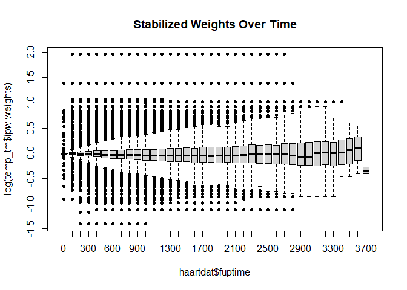

# ipw: Estimate Inverse Probability Weights

# ipw

The `ipw` package provides a flexible toolkit for estimating **Inverse
Probability Weights (IPW)** to fit marginal structural models. Functions
to estimate the probability to receive the observed treatment, based on
individual characteristics. The inverse of these probabilities can be
used as weights when estimating causal effects from observational data
via marginal structural models. Both point treatment situations and
longitudinal studies can be analysed. The same functions can be used to
correct for informative censoring.

## Key Features

- **Point Treatment & Longitudinal Data**: Functions to handle both
  static exposures and time-varying confounding.
- **Wide Range of Models**: Support for binomial, multinomial, ordinal,
  and continuous (Gaussian) exposures.
- **Survival Analysis**: Integration with Cox proportional hazards
  models for time-to-event data.
- **Diagnostic Tools**: Built-in plotting functions to assess weight
  stability and the positivity assumption.

## Installation

``` r

install.packages("ipw")
```

Or the development version from GitHub:

``` r

# install.packages("remotes")
remotes::install_github("TranHung93/ipw")
```

Documentation: <https://tranhung93.github.io/ipw/>; for a walk-through
of all features see the vignette,
[`vignette("ipw")`](https://tranhung93.github.io/ipw/articles/ipw.md) or
[Get started](https://tranhung93.github.io/ipw/articles/ipw.html).

## Example: Point Treatment Causal Inference

This example simulates data with a continuous confounder (`l`) and a
binomial exposure (`a`) to estimate a marginal causal effect of 10.

``` r

library(ipw)
library(survey)

# 1. Simulate data
set.seed(123)
n <- 1000
simdat <- data.frame(l = rnorm(n, 10, 5))
a.lin <- simdat$l - 10
pa <- exp(a.lin)/(1 + exp(a.lin))
simdat$a <- rbinom(n, 1, prob = pa)
simdat$y <- 10*simdat$a + 0.5*simdat$l + rnorm(n, -10, 5)

# 2. Estimate IPW weights
temp <- ipwpoint(
   exposure = a,
   family = "binomial",
   link = "logit",
   numerator = ~ 1,
   denominator = ~ l,
   data = simdat)

# 3. Fit Marginal Structural Model (MSM)
msm <- svyglm(y ~ a, 
              design = svydesign(~1, weights = ~temp$ipw.weights, data = simdat))

summary(msm)
#> 
#> Call:
#> svyglm(formula = y ~ a, design = svydesign(~1, weights = ~temp$ipw.weights, 
#>     data = simdat))
#> 
#> Survey design:
#> svydesign(~1, weights = ~temp$ipw.weights, data = simdat)
#> 
#> Coefficients:
#>             Estimate Std. Error t value Pr(>|t|)    
#> (Intercept)  -6.2885     0.2757  -22.81   <2e-16 ***
#> a            10.6622     0.8083   13.19   <2e-16 ***
#> ---
#> Signif. codes:  0 '***' 0.001 '**' 0.01 '*' 0.05 '.' 0.1 ' ' 1
#> 
#> (Dispersion parameter for gaussian family taken to be 22.76977)
#> 
#> Number of Fisher Scoring iterations: 2
```

## Example: Time-Varying Weights

For longitudinal research, such as the HIV cohort in `haartdat`, `ipwtm`
calculates the cumulative product of weights over time.

``` r

library(ipw)
library(survival)

data(haartdat)

# Estimate time-varying weights for HAART initiation
temp_tm <- ipwtm(
  exposure = haartind,
  family = "survival",
  numerator = ~ sex + age,
  denominator = ~ sex + age + cd4.sqrt,
  id = patient,
  tstart = tstart,
  timevar = fuptime,
  type = "first",
  data = haartdat
)

# Visualize weight stability
ipwplot(weights = temp_tm$ipw.weights, timevar = haartdat$fuptime, 
        binwidth = 100, main = "Stabilized Weights Over Time")
```



## ipw or WeightIt?

[WeightIt](https://ngreifer.github.io/WeightIt/) (Greifer) is a
comprehensive R package for weighting, and for many analyses it is the
better choice. The two packages overlap for simple cases (a binary point
treatment with a logistic model gives the same weights in both) and are
complementary otherwise.

**Use WeightIt** for point treatments when you want machine-learning or
balancing methods (generalized boosted models, SuperLearner, BART, CBPS,
entropy balancing, energy balancing, and more), a wide choice of
estimands, balance diagnostics through cobalt, and outcome models whose
standard errors account for the estimation of the weights
(`glm_weightit()`, `coxph_weightit()`, also for ordinal and multinomial
outcomes).

[PSweight](https://CRAN.R-project.org/package=PSweight) is another
option for point treatments, binary or with several levels: especially
for overlap (and matching or entropy) weights with built-in sandwich
standard errors that account for the estimated propensity score,
augmented (doubly robust) estimators, and survey or clustered data.

**Use [ipw](https://tranhung93.github.io/ipw/)** for

- exposures that change over time in **long (counting-process) data**,
  where each person has their own visit times:
  [`ipwtm()`](https://tranhung93.github.io/ipw/reference/ipwtm.md) fits
  one model pooled over all rows;
- **Cox models** for the time to the first switch of treatment or to
  censoring (`ipwtm(family = "survival")`);
- exposures that **switch back and forth or recur** (`type = "all"`,
  including Cox models for recurrent exposure events);
- **count and skewed continuous** exposures with built-in models
  (Poisson, negative binomial, gamma, log-normal);
- analyses with **few dependencies**.

A WeightIt analysis of a point treatment, with entropy balancing and an
outcome model whose standard errors account for the estimated weights:

``` r

W <- WeightIt::weightit(a ~ l, data = simdat, method = "ebal", estimand = "ATE")
fit <- WeightIt::glm_weightit(y ~ a, data = simdat, weightit = W)
summary(fit)$coefficients
#>              Estimate Std. Error   z value      Pr(>|z|)
#> (Intercept) -5.653647  0.3779844 -14.95736  1.394591e-50
#> a           10.684785  0.4998841  21.37453 2.306556e-101
```

An ipw analysis of time-varying data in long format (one row per patient
per interval, as in `haartdat` above), with weights for starting HAART
and for dropout, and a weighted Cox model:

``` r

w.start <- ipwtm(exposure = haartind, family = "survival", numerator = ~ sex + age,
                 denominator = ~ sex + age + cd4.sqrt, id = patient,
                 tstart = tstart, timevar = fuptime, type = "first", data = haartdat)
w.drop <- ipwtm(exposure = dropout, family = "survival", numerator = ~ sex + age,
                denominator = ~ sex + age + cd4.sqrt, id = patient,
                tstart = tstart, timevar = fuptime, type = "cens", data = haartdat)
msm.cox <- coxph(Surv(tstart, fuptime, event) ~ haartind + cluster(patient),
                 data = haartdat, weights = w.start$ipw.weights * w.drop$ipw.weights)
summary(msm.cox)$conf.int
#>          exp(coef) exp(-coef) lower .95 upper .95
#> haartind 0.3920629   2.550611 0.1614445 0.9521124
```

|  | ipw | WeightIt |
|----|----|----|
| Treatment types | binary, multinomial, ordinal, count (Poisson, negative binomial), continuous (normal, gamma, log-normal) | binary, multi-category (incl. ordinal), continuous (normal or other conditional density, or kernel density) |
| Methods | parametric models: [`glm()`](https://rdrr.io/r/stats/glm.html), `multinom()`, `polr()`, `glm.nb()`, GAMs (mgcv), Cox models; your own probabilities ([`ipwprobtm()`](https://tranhung93.github.io/ipw/reference/ipwprobtm.md)) | propensity score models (GLM, GBM, SuperLearner, BART, CBPS, …) and balancing methods (entropy, energy, stable balancing weights, …); user-defined methods |
| Estimands | ATE (stabilized or not); ATT, ATC, ATO for a binary, ATT and ATO for a categorical point treatment | ATE, ATT, ATC, ATO, ATM, ATOS (binary); ATE, ATT, ATC, ATO, ATM (multi-category) |
| Longitudinal data | long data, one row per person and interval; individual (irregular) visit times; one model pooled over time (pooled logistic, Cox, multinomial, ordinal, GEE) | `weightitMSM()`: wide data, one row per person, one model per time point (the same time points for everyone); weights multiplied over time points |
| Censoring | censoring weights with the same models, including Cox models (`type = "cens"`) | censoring weights with `.cens()` in `weightit()` and `weightitMSM()` |
| Outcome models and standard errors | fit with [`lm()`](https://rdrr.io/r/stats/lm.html), [`glm()`](https://rdrr.io/r/stats/glm.html), [`coxph()`](https://rdrr.io/pkg/survival/man/coxph.html), [`svyglm()`](https://rdrr.io/pkg/survey/man/svyglm.html) etc.; [`ipwvcov()`](https://tranhung93.github.io/ipw/reference/ipwvcov.md) (experimental) for M-estimation standard errors with binary exposures and logistic models: [`ipwpoint()`](https://tranhung93.github.io/ipw/reference/ipwpoint.md) weights with an [`lm()`](https://rdrr.io/r/stats/lm.html), [`glm()`](https://rdrr.io/r/stats/glm.html) or [`coxph()`](https://rdrr.io/pkg/survival/man/coxph.html) MSM, and [`ipwtm()`](https://tranhung93.github.io/ipw/reference/ipwtm.md) weights with an [`lm()`](https://rdrr.io/r/stats/lm.html), [`glm()`](https://rdrr.io/r/stats/glm.html) or counting-process [`coxph()`](https://rdrr.io/pkg/survival/man/coxph.html) MSM on the long data; otherwise the bootstrap | `glm_weightit()`, `ordinal_weightit()`, `multinom_weightit()`, `coxph_weightit()`: M-estimation, robust, bootstrap, fractional weighted bootstrap and cluster-robust standard errors |
| Trimming | truncation at percentiles (`trunc`) | `trim()` (trimming or truncation) |
| Diagnostics | [`ipwplot()`](https://tranhung93.github.io/ipw/reference/ipwplot.md); [`ipwdiag()`](https://tranhung93.github.io/ipw/reference/ipwdiag.md) (experimental): overlap, weight share and effective sample size, tail index, truncation sensitivity; balance with cobalt (weights passed as a vector) | [`summary()`](https://rdrr.io/r/base/summary.html) (weight ranges, effective sample size, …); full cobalt integration |
| Dependencies | MASS, nnet, survival, geepack | cobalt, ggplot2, cli, rlang, sandwich, generics, arg, plus optional packages for many methods |
| License | GPL (\>= 2) | GPL (\>= 2) |

A side-by-side comparison on the same data, including the standard
errors and what longitudinal data with individual visit times mean for
each package, is in the article [ipw, WeightIt and PSweight side by
side](https://tranhung93.github.io/ipw/articles/ipw-and-weightit.html),
which also shows that PSweight gives the same weights and standard
errors as ipw for binary and categorical point treatments.

## Authors

- **Hung Thai Tran** - Research Assistant, Biostatistics Group at OUCRU.
- **Willem M. van der Wal** - Original Author.
- **Ronald B. Geskus** - Head of Biostatistics, OUCRU.

## References

- Van der Wal W.M. & Geskus R.B. (2011). ipw: An R Package for Inverse
  Probability Weighting. *Journal of Statistical Software*, **43**(13),
  1-23.
- Robins J.M., Hernán M.A. & Brumback B.A. (2000). Marginal structural
  models and causal inference in epidemiology. *Epidemiology*, **11**,
  550-560.
- Greifer N. WeightIt: Weighting for Covariate Balance in Observational
  Studies. R package, <https://ngreifer.github.io/WeightIt/>.
- Zhou T., Tong G., Li F., Thomas L. & Li F. PSweight: Propensity Score
  Weighting for Causal Inference with Observational Studies and
  Randomized Trials. R package,
  <https://CRAN.R-project.org/package=PSweight>.
